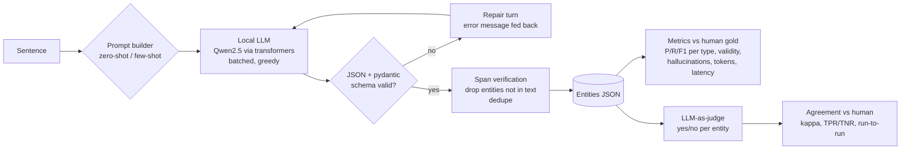

# xtract: measured structured extraction with local LLMs

[](https://github.com/Adversitas/llm-extraction-eval/actions/workflows/ci.yml)

An evaluation harness for **turning free text into validated JSON with an open-weight LLM that
runs on your own hardware**. It answers the questions a team asks before putting an extraction
pipeline into production:

- *Which prompting strategy works best, and what does it cost?* Zero-shot or few-shot,
  with or without a validate-and-repair loop and a span-verification guard.
- *How often does the model break the schema, or invent entities that are not in the text?*
- *Which model size is worth it?* Quality vs latency vs tokens.
- *Can an LLM-as-judge replace human review?* Agreement with human annotations, bias and
  run-to-run stability.

Everything is measured against **human annotations** (CoNLL-2003 English named entities) with
Qwen2.5 Instruct models (0.5B, 1.5B, 3B) running locally through `transformers` on one laptop
GPU (RTX 4060, 8 GB). No text leaves the machine.

## Results

300 test sentences (seeded sample, ≥ 6 tokens), greedy decoding, batches of 16. Produced by
`xtract run` and `xtract report` (full tables in [`reports/results.md`](reports/results.md)).

| Model | Strategy | Precision | Recall | **Micro-F1** | Valid JSON 1st pass | Hallucinated entities / 100 docs | Prompt tokens / doc | ms / doc (p50) |
|---|---|---|---|---|---|---|---|---|
| Qwen2.5-0.5B | zero-shot | 0.394 | 0.260 | 0.313 | 98.7 % | 30.0 | 142 | 338 |
| Qwen2.5-0.5B | few-shot + repair + verify | 0.250 | 0.490 | 0.331 | 99.0 % | 0 | 301 | 640 |
| Qwen2.5-1.5B | zero-shot | 0.399 | 0.485 | 0.438 | 97.3 % | 57.7 | 142 | 490 |
| Qwen2.5-1.5B | few-shot + repair | 0.427 | 0.542 | 0.478 | 97.7 % | 19.7 | 305 | 516 |
| Qwen2.5-1.5B | few-shot + repair + verify | 0.463 | 0.542 | 0.499 | 97.7 % | 0 | 305 | 516 |
| Qwen2.5-3B | zero-shot | 0.428 | 0.537 | 0.476 | 100 % | 10.7 | 142 | 775 |
| Qwen2.5-3B | few-shot + repair | 0.490 | 0.710 | 0.580 | 100 % | 13.7 | 296 | 624 |
| **Qwen2.5-3B** | **few-shot + repair + verify** | **0.518** | **0.710** | **0.599** | 100 % | **0** | 296 | 624 |

F1 per type for the best configuration (3B, few-shot + repair + verify): persons 0.867,
organizations 0.604, locations 0.628, misc 0.142.

**LLM-as-judge vs human annotation** (300 entities extracted by the 0.5B model, balanced 50/50
correct/incorrect according to the gold annotation; `xtract judge`):

| Judge | Accuracy vs human | Cohen's κ | Says "yes" | TPR | TNR | Agreement between two sampled runs (T = 0.7) |
|---|---|---|---|---|---|---|
| Qwen2.5-1.5B | 0.583 | 0.167 | 91.7 % | 1.000 | 0.167 | 98.3 % |
| Qwen2.5-3B | 0.753 | 0.507 | 66.7 % | 0.920 | 0.587 | 97.7 % |

What the numbers say:

- **Few-shot examples matter more than model size at the margin.** For the 3B model, three
  annotated examples lift recall from 0.54 to 0.71 and F1 from 0.48 to 0.58, for twice the
  prompt tokens. Few-shot did not help the 0.5B model: it copies the example format but labels
  much worse (precision 0.39 → 0.22).
- **A deterministic span check is a free win.** Dropping any entity that is not literally in the
  sentence removes every hallucination (up to 58 per 100 documents for the 1.5B model zero-shot)
  and adds 2 to 4 F1 points, at no extra model call.
- **Schema validity was not the bottleneck.** Pydantic validation passed on 97 to 100 % of first
  answers. The repair loop recovered most failures in the few-shot setting (1.5B: 97.7 % →
  99.7 %; 0.5B: 99.0 % → 100 %) but none of the 1.5B model's zero-shot failures (97.3 % before
  and after: it repeated the same malformed output). Validity is necessary, not sufficient: a
  schema-valid answer can still be wrong.
- **A small LLM judge is not a reviewer.** The 1.5B judge approves 92 % of candidates, including
  83 % of the wrong ones (κ = 0.17). The 3B judge is moderately reliable (κ = 0.51) but still
  lets 41 % of wrong entities through. Both are stable across sampled runs (≈ 98 % agreement), so
  their problem is **bias, not noise**: running the judge several times would not fix it. In a
  production setting an LLM judge this size can triage, but its verdicts need calibration
  against a human-labelled set like this one before anyone trusts them.
- Context: a fine-tuned NER model reaches ≈ 0.9 F1 on CoNLL-2003. A 3B general model prompted
  in-context reaches 0.60 under strict exact-string matching (e.g. *"the EU"* vs *"EU"* counts as
  an error). That gap is the cost of skipping training data, and the case for fine-tuning or a
  larger model once the volume justifies it.

## Architecture



Code map (`src/xtract/`):

| Module | Role |
|---|---|
| `data.py` | Downloads CoNLL-2003 (Hub parquet export), BIO tags → entity lists, seeded sampling, few-shot example selection covering all types |
| `schema.py` | `Entities` pydantic model (extra keys forbidden), tolerant JSON block extraction (code fences, prose around JSON) |
| `llm.py` | `HFBackend` (chat template, left padding, batched generation, token and latency accounting) and `FakeBackend` for tests |
| `pipeline.py` | Strategies, repair loop, span verification; first-pass generations are shared between strategies so comparisons are paired |
| `metrics.py` | Multiset entity matching, micro / per-type P/R/F1, Cohen's kappa |
| `judge.py` | Balanced judge items, yes/no judge prompt, agreement statistics |
| `cli.py` | `xtract download / run / judge / report` |

## How to run

```bash
pip install -e ".[llm,dev]"          # torch + transformers for the local models
xtract download                      # CoNLL-2003 parquet into data/ (not redistributed)
xtract run --model Qwen/Qwen2.5-3B-Instruct --n 300
xtract judge --judge-model Qwen/Qwen2.5-3B-Instruct \
  --results reports/qwen2.5-0.5b-instruct/results.jsonl \
  --out reports/judge_qwen2.5-3b-instruct_on_0.5b.json
xtract report                        # rebuilds reports/results.md
pytest -q && ruff check . && ruff format --check .
```

The CI installs only the light dependencies: tests run the whole pipeline (parsing, repair,
verification, metrics, judge) against a scripted fake model, it checks the CoNLL conversion on
the real download, and it rebuilds the results tables from the committed run outputs.

## Limitations

- **One task, one language.** CoNLL-2003 is English news NER. It has human gold labels,
  which is why it was chosen, but business extraction (invoices, contracts, emails, often in
  French) has other schemas and harder fields; the harness is generic, the numbers are not.
- **Strict matching.** Exact normalised strings; partial or boundary-shifted answers count as
  wrong. A lenient (overlap) metric would give higher scores.
- **Small models only**, chosen to fit an 8 GB GPU. Larger or API-hosted models were not
  measured, so the model-selection conclusion is limited to this range.
- **300 sentences**: differences of 1 to 2 F1 points between strategies are within noise; the
  larger gaps discussed above are not.
- **Latency** is per document within a batch of 16 on a laptop GPU shared with other jobs;
  it is useful for comparing strategies, not as a production SLA.
- The judge was tested on one judged model's outputs (0.5B) and one prompt.
- The corpus derives from Reuters news and is not redistributable: it is downloaded at run
  time, and the committed outputs contain document ids and predictions but no source sentences.

## En bref (FR)

Banc d'évaluation pour **l'extraction d'informations structurées (JSON) par des LLM open source
exécutés en local** (Qwen2.5 0,5B / 1,5B / 3B sur un GPU portable), mesuré contre des annotations
humaines (CoNLL-2003). Il compare des stratégies (zero-shot, few-shot, boucle de validation et
de correction par schéma pydantic, vérification des entités dans le texte) sur la qualité
(précision, rappel, F1 par type), la validité du JSON, les hallucinations, les tokens et la
latence. Meilleur résultat : **F1 0,599 avec le 3B en few-shot + vérification, zéro
hallucination**. Il évalue aussi un **LLM-juge** face aux annotations humaines : le juge 3B
atteint un kappa de 0,51 mais laisse passer 41 % des erreurs, le juge 1,5B approuve 92 % des
candidats. Leur défaut est un biais et non du bruit (98 % d'accord entre deux tirages), ce qui
impose de les calibrer sur un jeu annoté avant de leur faire confiance.

## License

MIT (code). CoNLL-2003 is not included; see its original terms. Qwen2.5 models are under their
own licenses (Apache-2.0 for 0.5B and 1.5B, Qwen Research License for 3B).
